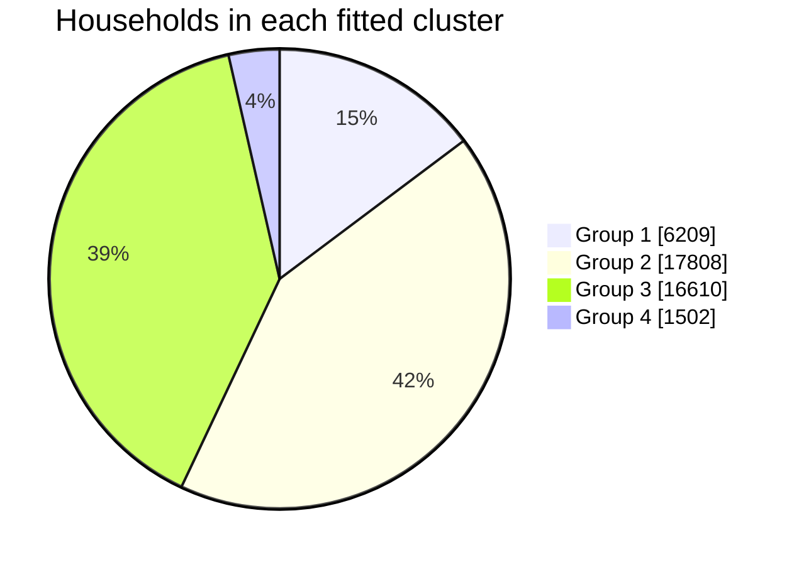

# SchemeMatch

**How can two groups of households earn almost the same income and still look very different?** In the Indian survey behind SchemeMatch, two clusters average around ₹1.36 lakh a year. One averages nearly nine people per household, the other just over four.

SchemeMatch is a Python research dashboard by **Ishan Nayak** at **Lovely Professional University**. Explore household patterns with unsupervised learning, then use a five-question screener to discover Indian public schemes worth investigating.

[Explore the results](#the-indian-household-model) · [Take the demo tour](#demo-tour) · [Run the app](#run-the-app) · [Try the API](#try-the-api)

## The Indian household model

The saved model uses the **2011–12 India Human Development Survey (IHDS-II)** household file. Of 42,152 records, 42,129 had complete values for annual income, household size and asset index. The model selected K-means with four clusters. [Survey and access details](https://ihds.umd.edu/data/ihds-2)



<details>
<summary><strong>Compare the four household profiles</strong></summary>

| Group | Households | Mean annual income | Mean household size | Mean asset index |
|---|---:|---:|---:|---:|
| 1 | 6,209 | ₹1,35,544 | 8.76 | 15.48 |
| 2 | 17,808 | ₹1,36,747 | 4.26 | 20.40 |
| 3 | 16,610 | ₹49,768 | 3.95 | 9.19 |
| 4 | 1,502 | ₹8,52,113 | 5.78 | 25.45 |

These are unweighted means for the analyzed survey records. The rupee amounts refer to the survey period. Group numbers identify clusters within this fitted model.

</details>

<details>
<summary><strong>Why did K-means win?</strong></summary>

The pipeline splits the records 75/25, fits the feature transformations on the training split and compares K-means with diagonal-covariance Gaussian mixtures. It tries two through six groups where the data support them. Candidates must produce every proposed group on the validation sample.

The four-group K-means model had the highest silhouette score, **0.355**, across the **800 held-out households scored**. Its Davies–Bouldin score was **0.916**. Silhouette measures cluster separation and ranges from −1 to 1. The selected pipeline was then refitted on all 42,129 complete households. [Read the model selection code](schemematch/model.py)

</details>

## Demo tour

| Open this tab | Try this |
|---|---|
| **Saved model** | Compare Groups 1 and 2. Rotate the 3D landscape and inspect the profile table. The published projection groups sample points into grid cells and omits cells with fewer than five observations per group. |
| **Scheme matcher** | Answer **Yes** only to the question about an adult lacking a bank account. The app returns PM Jan Dhan Yojana with a reason and an official link. The administering authority determines eligibility. |
| **Cluster lab** | Upload your own de-identified household CSV and compare model families on that cohort. |
| **Benchmark** | Explore an independent methods demo using 235 Belgian households and two spending variables. [Engel dataset](https://www.statsmodels.org/stable/datasets/generated/engel.html) |

<details>
<summary><strong>Which columns should my CSV contain?</strong></summary>

For IHDS-II, use this header with one household per row:

```csv
INCOME,NPERSONS,ASSETS
```

For a survey with directly observed outreach indicators, use:

```csv
annual_income_inr,household_size,unbanked_adult,no_lpg,owns_farmland
```

Use 0 or 1 for each indicator. Recode survey-specific missing values before uploading. The lab accepts up to 2,000 input rows, requires at least 40 complete households and limits the request to 2 MB.

</details>

## Run the app

With repository access and Python 3.12 installed, run these commands on macOS or Linux:

```bash
git clone https://github.com/ishannayak0004-spec/schemematch-live.git
cd schemematch-live
python3.12 -m venv .venv
source .venv/bin/activate
python -m pip install -r requirements.txt
python app.py
```

Open [the local dashboard](http://127.0.0.1:7860/) or [the saved Indian model](http://127.0.0.1:7860/model). The repository includes the fitted model, so the first demo needs no survey download. For hosting, the included Render Blueprint specifies the Python runtime, Gunicorn start command and free instance type. [View deployment configuration](render.yaml)

## Try the API

<details>
<summary><strong>Predict the cluster for one example household</strong></summary>

With the app running, send a hypothetical household with annual income of ₹73,500, four members and an asset index of 16:

```bash
curl -X POST http://127.0.0.1:7860/api/predict \
  -H 'Content-Type: application/json' \
  -d '{"annual_income_inr":73500,"household_size":4,"asset_index":16}'
```

Response from the included model:

```json
{"distance_to_center": 0.738, "group": 2}
```

The distance is measured in transformed feature space. For scheme suggestions, submit the five boolean answers to `POST /api/match`. For cohort analysis, submit a CSV as multipart field `survey` to `POST /api/analyze`.

</details>

<details>
<summary><strong>Follow a request through the Python source</strong></summary>

| Component | Responsibility |
|---|---|
| [Flask routes](app.py) | Receive form submissions and API requests and render the dashboard. |
| [Data preparation](schemematch/data.py) | Select features, validate ranges and audit excluded records using pandas and NumPy. |
| [ML pipeline](schemematch/model.py) | Fit and score scikit-learn models, project observations with PCA and assign new households. |
| [Interactive charts](schemematch/charts.py) | Build Plotly projections and model comparisons, and smooth density estimates with SciPy. |
| [Scheme screening](schemematch/schemes.py) | Apply explicit screening rules and point visitors to official scheme information. |

</details>
